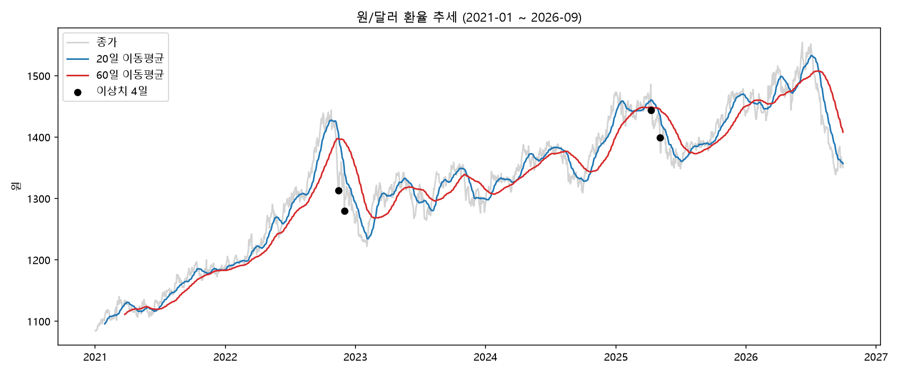
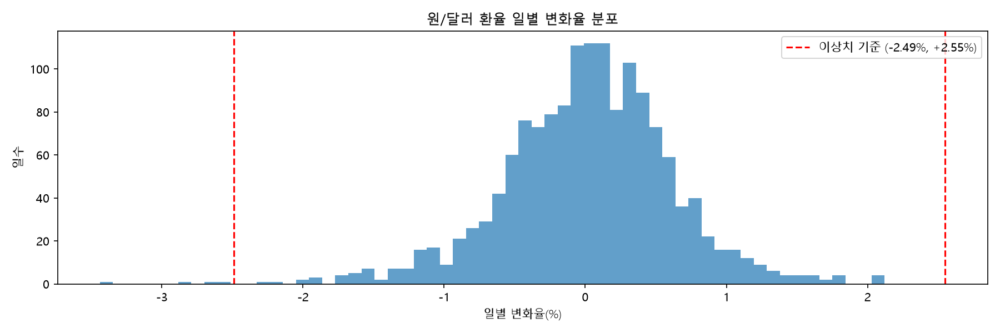
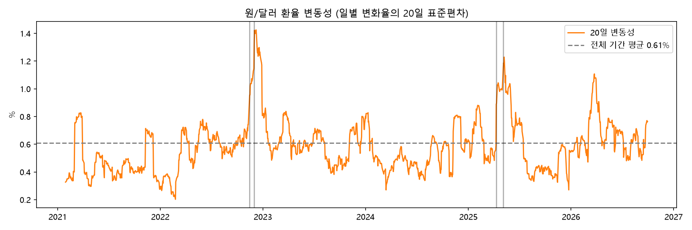
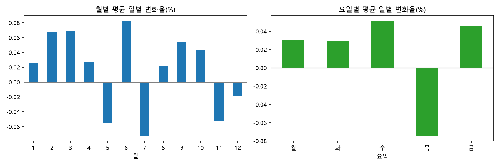

# 원/달러 환율 분석 리포트 (2021.01 ~ 2026.09)

원/달러 환율이 지난 5년 반 동안 어떻게 움직였는지 살펴보고, 특히 하루 만에 크게 출렁인 날에는 무슨 일이 있었는지 찾아본 분석입니다. 코드와 실행 방법은 [README.md](README.md)에 있습니다.

## 1. 알고 싶었던 것

분석을 시작하기 전에 네 가지 질문을 세웠습니다.

1. **추세**: 환율은 5년 반 동안 어떤 흐름으로 움직였을까?
2. **급변동**: 하루 만에 크게 움직인 날은 언제이고, 그날 무슨 일이 있었을까?
3. **변동성**: 환율이 특히 불안정했던 시기는 언제일까?
4. **월별·요일별 패턴**: 특정 월이나 요일에 환율이 일정하게 움직이는 경향이 있을까?

## 2. 데이터

- **출처**: Yahoo Finance (`yfinance` 라이브러리, 티커 `KRW=X`)
- **기간**: 2021-01-01 ~ 2026-09-30
- **데이터 수**: 1,494개 (영업일 기준)
- **사용한 값**: 종가(`Close`)만 썼습니다. `Adj Close`는 종가와 같았고 `Volume`은 0이라 뺐습니다.
- **정제**: 결측값, 중복, 0 이하 값은 없었습니다. 날짜가 비는 곳은 5일 간격 1곳(2025-04-22 직전)과 2일 간격 3곳이었는데, 보간하지 않고 그대로 썼습니다.
- **기간 통계**: 평균 약 1,324원, 최저 1,084.65원(2021-01-01), 최고 1,554.48원(2026-06-08), 일별 변화율의 표준편차 0.61%
- **이상치 기준**: 일별 변화율의 IQR 3배(-2.49% ~ +2.55%)를 벗어나는 날을 이상치로 봤습니다. 모두 4일이었고, 4일 모두 하락 방향이었습니다.
- **주의**: Yahoo Finance 데이터는 개인 학습·분석 목적으로 사용했으며 상업적 이용은 제한될 수 있습니다. 데이터 제공 사정에 따라 값이 달라질 수 있어 CSV 원본을 함께 저장했습니다.

## 3. 분석 방법

질문마다 어울리는 방법을 하나씩 골랐습니다.

- 추세: 20일·60일 이동평균으로 잔물결을 걷어내고 큰 흐름을 봤습니다.
- 급변동: 일별 변화율의 분포를 그리고, 평소 범위를 벗어난 날을 찾았습니다.
- 변동성: 일별 변화율의 20일 표준편차를 계속 계산해서 불안정했던 시기를 찾았습니다.
- 월별·요일별 패턴: 월별·요일별 평균 변화율을 비교했습니다.

## 4. 분석 결과

### 4-1. 추세

환율은 2021년 초 약 1,085원에서 2026년 6월 최고점(1,554.48원)까지 약 43% 올랐습니다. 하지만 꾸준히 오르기만 한 건 아니었습니다.

- 2022년 가을에 한 번 고점을 찍은 뒤 2023년 초까지 내려왔습니다.
- 2023년은 그래프상 대략 1,270~1,350원대에서 움직였습니다.
- 2025년 봄과 2026년 여름에도 고점 뒤에 하락 구간이 이어졌고, 2026년 9월 말에는 1,350원대까지 내려왔습니다.

그래프의 검은 점이 이상치 4일인데, 추세가 꺾이는 구간에 놓여 있습니다.

### 4-2. 급변동한 날

일별 변화율은 대부분 -1% ~ +1% 사이에 모여 있습니다. 평소 범위를 벗어난 날은 4일이었고, 모두 급락이었습니다. 급등 쪽 이상치는 하나도 없어서 분포의 왼쪽 꼬리가 더 깁니다.

이 4일이 데이터 오류인지 실제 변동인지 먼저 확인했습니다. 각 날짜의 전후 일주일 값을 보니, 하루만 튀었다가 곧바로 돌아오는 모양이 아니라 변동이 이어졌습니다. 그래서 실제 변동일 가능성이 높다고 보고, 날짜별로 뉴스를 찾아 기사를 직접 읽어 봤습니다.

**2022-11-14 (-2.69%)**
이 시기의 배경은 미국 연준의 긴축이었습니다. 2022년 10월까지는 연준이 금리를 급하게 올리면서 달러가 강해졌고, 환율이 1,400원대까지 치솟았습니다. 그런데 11월에 미국 10월 소비자물가가 예상보다 낮게 나오자, 연준이 긴축 속도를 늦출 것이라는 기대가 커지면서 달러가 약해졌습니다. 긴축 때문에 환율이 내려간 것이 아니라, 긴축이 누그러질 거라는 기대 때문에 흐름이 바뀐 것입니다.

서울 시장에서는 이 충격이 11월 11일 하루에 59.1원 하락(1,377.5원 → 1,318.4원)으로 나타났습니다. 그런데 제 데이터(Yahoo Finance)에서는 같은 하락이 11-11과 11-14 두 날에 나뉘어 기록되어 있었습니다. 11-10부터 11-14까지의 하락폭을 합치면 약 57.5원으로, 서울 시장의 하루 하락폭과 거의 같습니다. 그래서 11-14의 하락은 소비자물가 충격의 뒷부분이라고 해석했습니다.
출처: [머니투데이 2022-11-11](https://www.mt.co.kr/society/2022/11/11/2022111115382739865), [머니투데이 2022-11-15](https://www.mt.co.kr/economy/2022/11/15/2022111516180294327), [KB국민은행](https://kbthink.com/main/economy/issue_and_news/exchange-issue-report/exchange-issue-report-231107.html)

**2022-12-01 (-3.44%)**
파월 연준 의장이 연설에서 빠르면 12월부터 금리 인상 속도를 늦추는 게 합리적이라고 말했고, 같은 시기 미국 민간 고용도 예상보다 약하게 나왔습니다. 파월 의장은 최종 금리가 예상보다 높아질 수 있고 높은 금리를 당분간 유지해야 한다는 말도 함께 했습니다. 하지만 시장은 "인상 속도를 늦춘다"는 부분에 주목했고, 달러가 약해지면서 환율이 장 초반에 1,300원 아래로 내려갔습니다. 금리를 높게 유지하겠다는 말보다, 인상 폭이 줄어든다는 신호가 더 크게 받아들여진 것입니다.
출처: [블록미디어](https://www.blockmedia.co.kr/archives/276241), [시사경제](https://www.sateconomy.co.kr/news/view/1065584845786841), [인베스팅닷컴](https://kr.investing.com/analysis/article-200441943)

**2025-04-10 (-2.84%)**
트럼프 정부가 중국을 뺀 나머지 나라의 상호관세를 90일 동안 미루겠다고 발표했습니다. 직전까지 관세 전쟁 우려로 환율이 높은 수준이었는데(제 데이터 기준 04-09 종가 1,486.13원), 유예 발표로 뉴욕증시가 급등하고 위험을 감수하려는 분위기가 돌아오면서 원화가 강해졌습니다.
출처: [블록미디어](https://www.blockmedia.co.kr/archives/887549), [KB국민은행](https://kbthink.com/main/economy/exchangerate/daily-exchange-trend/2025/daily-exchange-trend-250410.html)

**2025-05-05 (-2.52%)**
이날은 서울 외환시장이 쉬는 날(연휴 5월 3~6일)이라, 이 값은 해외(역외) 시장에서 거래된 가격입니다. 연휴 동안 대만 달러가 9% 넘게 오르는 등 아시아 통화가 강세를 보였고, 원화도 같이 움직여 역외 원/달러가 4% 이상 내려갔습니다. 미국이 대만과의 관세 협상에서 통화 절상을 압박했다는 소식과 미중 무역협상 기대가 배경으로 보도됐습니다. 연휴가 끝나고 서울 시장이 5월 7일 문을 열었을 때, 환율은 연휴 전 마지막 거래일(5월 2일) 주간 종가보다 25.3원 낮은 1,380원으로 시작했습니다.
출처: [파이낸셜뉴스](https://www.fnnews.com/news/202505070918075958), [MBC](https://imnews.imbc.com/news/2025/econo/article/6713489_36737.html)

**처리 기준**: 네 날 모두 오류가 아니라 실제 시장 사건과 이어진 변동이어서, 지우지 않고 그대로 분석에 썼습니다. 다만 뉴스는 같은 시기에 있었던 사건일 뿐이고, 그것이 환율 변동의 원인이라고 증명한 건 아닙니다.

### 4-3. 변동성

| 연도 | 평균 변동성 (20일, %) |
|---|---|
| 2021 | 0.46 |
| 2022 | 0.64 |
| 2023 | 0.60 |
| 2024 | 0.53 |
| 2025 | 0.60 |
| 2026 (9월까지) | 0.67 |

연평균만 보면 해마다 큰 차이가 없습니다(0.46~0.67%). 진짜 차이는 사건이 있을 때 생겼습니다. 평소 0.5~0.6%대이던 변동성이 가장 높을 때는 1.42%까지 올라, 전체 평균(0.61%)의 약 2.3배가 됐습니다.

이 최고값의 날짜는 2022-12-08인데, 그날 사건이 있었다는 뜻은 아닙니다. 그날까지의 20일 구간 안에 이상치 두 날(2022-11-14, 2022-12-01)이 들어 있어서 값이 가장 높아진 것입니다. 변동성이 높았던 두 시기(2022년 11~12월, 2025년 4~5월)가 이상치 4일과 겹친다는 점도 눈에 띄었습니다.

### 4-4. 월별·요일별 패턴

- 월별 평균 일별 변화율은 -0.072% ~ +0.082% 범위였습니다. 가장 높은 달은 6월(+0.082%), 가장 낮은 달은 7월(-0.072%)입니다. 오른 달은 1~4월, 6월, 8~10월이고, 내린 달은 5월, 7월, 11월, 12월입니다.
- 요일별로는 목요일(-0.074%)만 하락이고, 나머지 요일은 +0.03% ~ +0.05%였습니다.
- 하지만 이 평균의 차이(월별 최대 약 0.15%p, 요일별 최대 약 0.13%p)는 하루 변동 폭(표준편차 0.5~0.8%)에 비하면 아주 작습니다. 하루하루의 출렁임에 묻힐 정도라서, 특정 월이나 요일에 환율이 일정하게 오르거나 내리는 **뚜렷한 패턴은 없다**고 판단했습니다.
- 요일별 결과는 Yahoo Finance 값과 서울 종가의 시점 차이 때문에 왜곡됐을 수 있습니다.

## 5. 인사이트

### 하나. 고점을 찍은 뒤 크게 내려오는 일이 반복됐습니다
- **관찰**: 환율은 5년 반 동안 약 43% 올랐지만, 2022년 가을, 2025년 봄, 2026년 여름처럼 고점 뒤에 하락 구간이 이어졌습니다.
- **원인**: 2022년 11~12월의 하락은 연준의 긴축 속도가 누그러질 거라는 기대 때문이었고, 2025년 4월의 하락은 관세 유예 발표 때문이었습니다. 2026년 하반기 하락의 원인은 확인하지 못했습니다.
- **행동**: 환율이 많이 오른 시기에 미국 금리나 관세 소식이 나오면, 하락할 가능성도 함께 생각해 봅니다. (분석 결과를 활용하는 일반적인 예시이고, 투자 조언은 아닙니다.)

### 둘. 변동성은 평소엔 낮다가 사건이 있을 때 두 배 넘게 뛰었습니다
- **관찰**: 평소 0.5~0.6%대이던 변동성이 최대 1.42%까지 올랐고, 그 시기가 이상치 4일과 겹쳤습니다.
- **원인**: 미국 소비자물가 둔화(2022-11), 파월 의장의 발언(2022-12), 트럼프 정부의 관세 유예 발표(2025-04), 아시아 통화 강세(2025-05)처럼 해외에서 나온 소식이었습니다.
- **행동**: 미국 소비자물가나 FOMC 발표가 있는 주에는 환율이 크게 움직일 수 있다고 보고, 환율에 민감한 일정에는 여유를 둡니다.

### 셋. 급변동은 오류가 아니라 뉴스로 설명되는 실제 변동이었습니다
- **관찰**: 이상치 4일은 모두 급락이었고, 급등 쪽 이상치는 없었습니다.
- **원인**: 네 날 모두 달러 약세나 위험선호 회복을 부른 뉴스와 이어집니다. (2025-05-05는 서울 휴장일의 해외 거래 가격입니다.)
- **행동**: 이상치를 지우지 않고 그대로 두되, 시점 차이와 휴장일 가격이라는 점을 한계로 기록합니다.

## 6. 결론과 한계

### 결론
- 원/달러 환율은 5년 반 동안 약 1,085원에서 1,554원까지 올랐고, 고점 뒤에 하락 구간이 반복됐습니다.
- 변동성은 평소엔 안정적이다가 미국 금리·관세 같은 외부 소식이 있을 때 잠깐 크게 커졌습니다.
- 이상치로 잡힌 4일은 모두 뉴스로 설명되는 실제 변동이었습니다.
- 월별·요일별로 환율이 일정하게 움직이는 뚜렷한 패턴은 없었습니다.

### 한계
- Yahoo Finance의 일별 값은 서울 외환시장 종가와 시점이 달라서, 급락이 하루에 몰린 사건이 두 날짜로 나뉘어 기록될 수 있습니다. 예를 들어 2022-11-11의 소비자물가 충격은 11-11과 11-14에 나뉘어 반영됐고, 2025-05-02는 서울 주간 종가가 1,405.3원인데 제 데이터에는 1,435.10원으로 기록되어 있습니다. 요일별 분석은 이 영향을 받았을 수 있습니다.
- 2025-05-05(와 05-06)는 서울 휴장일의 해외 거래 가격입니다.
- 뉴스에서 찾은 원인은 같은 시기에 보도된 사건과의 연결일 뿐, 인과관계를 증명한 것이 아닙니다.
- 2026년 하반기에 환율이 크게 내려온 이유는 확인하지 못했습니다.
- 한 곳(Yahoo Finance)의 데이터만 썼고, 2026년은 9월까지의 데이터입니다.

## 7. AI 사용 로그

| 단계 | AI에게 맡긴 일 | 제가 확인한 일 |
|---|---|---|
| 환경 준비 | Git·Python 설치 안내. Python 3.15에서 패키지 설치가 실패해 3.13 가상환경(.venv)으로 해결 | 설치 후 버전을 확인하고 노트북이 실행되는지 확인 |
| 이상치 확인 | 이상치 4일의 전후 7일 값을 출력하는 코드 | 출력된 값을 보고 하루만 튀는 오류인지, 변동이 이어지는 실제 변동인지 직접 판단 |
| 원인 조사 | 날짜별 뉴스 검색과 원인 후보 정리. 2022-11-14는 처음에 당일 기사를 찾지 못해 다시 검색을 요청 | 4일의 기사를 직접 열어 확인함. 2022-11-14는 연준의 긴축 속도 조절 기대, 2022-12-01은 파월 의장의 금리 관련 발언, 2025-04-10은 트럼프 정부의 관세 유예 발표, 2025-05-05는 아시아 통화 강세를 확인함 |
| 분석·그래프 | 분석 기법 추천, 이동평균·변동성·변화율 분포·월별 요일별 그래프 코드 | 그래프를 보고 해석이 맞는지 직접 확인 |
| 인사이트 | 관찰·원인·행동 초안 | 기사를 확인한 뒤, 이상치 원인 설명의 표현을 AI와 함께 고침(2022-11-14는 "긴축 때문"이 아니라 "긴축 속도 조절 기대", 2022-12-01은 "금리 인상 유지"가 아니라 "인상 속도 조절 신호"로 정리) |

### 검증하면서 알게 된 점
- 2022-11-14는 서울 종가를 확인해 보니 큰 하락이 11-11에 있었습니다(-59.1원). 제 데이터에서는 그 하락이 11-11과 11-14에 나뉘어 기록된 것으로 판단했습니다.
- 기사를 확인하며 메모했던 "긴축에 의해"(2022-11-14), "금리 인상 유지"(2022-12-01)라는 표현은, 환율이 내려간 이유가 긴축 자체가 아니라 긴축이 누그러질 거라는 기대였다는 점으로 AI와 함께 바로잡았습니다.
- 2025-05-05는 서울 휴장일의 해외 거래 가격이라는 점을 한계에 적었습니다.